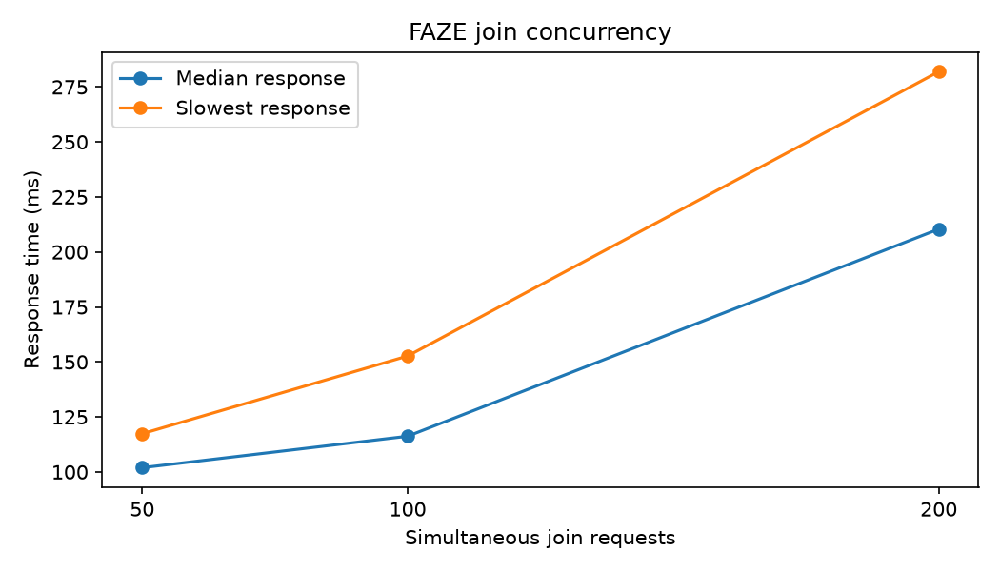

# Experiments

## Concurrency

Re-run with the local API running:

~~~bash
node db/perf/join-load.js
~~~

FAZE groups are capped at 10 members, so each run used one owner and nine free seats. The script sent 50, 100 and 200 simultaneous join requests from distinct temporary users through the real HTTP API. Each size was run three times.

| Requests | Run | Joined | Full | Over limit | Median ms | Slowest ms |
| ---: | ---: | ---: | ---: | :---: | ---: | ---: |
| 50 | 1 | 9 | 41 | no | 158.0 | 176.7 |
| 50 | 2 | 9 | 41 | no | 81.4 | 98.9 |
| 50 | 3 | 9 | 41 | no | 66.4 | 76.5 |
| 100 | 1 | 9 | 91 | no | 101.4 | 161.0 |
| 100 | 2 | 9 | 91 | no | 124.2 | 147.5 |
| 100 | 3 | 9 | 91 | no | 123.1 | 149.6 |
| 200 | 1 | 9 | 191 | no | 179.3 | 310.5 |
| 200 | 2 | 9 | 191 | no | 232.7 | 272.2 |
| 200 | 3 | 9 | 191 | no | 219.1 | 263.1 |

Every run stayed at or below the 10-member limit. Only the nine available seats were taken; the rest were rejected as full. The stored member count matched the real active membership rows after every run. This remains correct because sp_join_group locks the group row with SELECT ... FOR UPDATE, so concurrent joins serialize around the capacity check.

