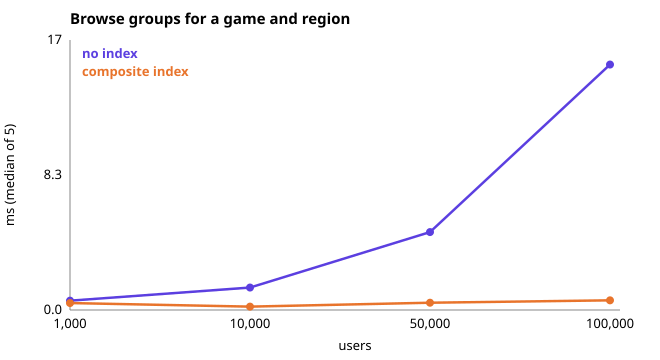
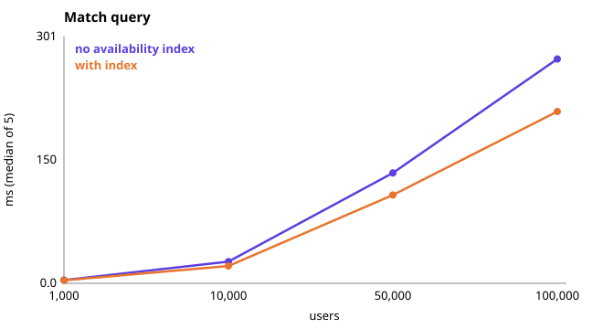

# Experiments

Measured evidence for the final report: how our design compares with simple
baselines, how it scales, how it behaves under concurrent joins, and where it is
weak. All timings are the median of 5 runs after one warm-up run, on one
development machine with MySQL 8. Compare numbers within a table, not across
machines.

## How to re-run

Baselines and scaling (needs the game catalog: `npm run etl:all`; takes a few
minutes because it rebuilds a throwaway `faze_perf` database at four sizes):

```bash
npm run build --workspace=@faze/server
node db/perf/experiments.js
```

It prints the tables below and rewrites the two charts in `docs/img/`. The data
comes from `db/perf/load.sql`: `N` users with three games and three weekly slots
each, and `N / 4` open groups of one to four members, all made from plain
arithmetic so every run builds the same rows.

## Baselines

Each baseline is the simple design we did **not** choose, measured on the
100,000-user data set.

### 1. One flat table instead of a normalised schema

A single `flat_user_game` table (user, display name, region name, game id, game
title) holds the same facts as `user`, `profile`, `region`, `user_game` and
`game`: 300,000 rows. The cost shows up when a fact changes:

| Change                     | Rows updated, flat table | Rows updated, normalised |
| -------------------------- | -----------------------: | -----------------------: |
| Rename the most-owned game |                      600 |                        1 |
| Rename a region            |                   37,500 |                        1 |

In the flat table every copy must be found and changed, and a missed copy leaves
two different names for one game. It also cannot store a game that nobody owns
yet. The normalised schema stores each fact once, which is the point of 3NF.

### 2. Ranking in app code instead of in SQL

The same ranking written in Node: fetch every open group, every active member
and every availability slot, then score them in JavaScript.

| Match ranking           | Time (ms) | Rows sent to Node | Same top 20 |
| ----------------------- | --------: | ----------------: | :---------: |
| In SQL (what FAZE runs) |       214 |                20 |     yes     |
| In app code             |       637 |           387,504 |             |

Both give the same top 20. The SQL version is three times faster and sends 20
rows instead of 387,504, because the filtering and the overlap arithmetic run
next to the data and use its indexes.

### 3. Stored member count instead of `COUNT(*)`

"How many open groups have a free seat?", answered two ways:

| Method                                       | Time (ms) | Answer |
| -------------------------------------------- | --------: | -----: |
| Stored `member_count` (kept by triggers)     |       8.9 | 25,000 |
| `COUNT(*)` of active members for every group |      80.2 |   same |

The stored count is nine times faster for the same answer. This is the one
deliberate denormalisation in the schema; the triggers keep it correct, and
`v_member_count_reconciliation` showed zero drift on the 100,000-user data.

## Scaling

The two queries a user waits for, at four sizes, with and without their indexes
(times in milliseconds):

|   Users | Browse, no index | Browse, indexed | Match, no index | Match, indexed |
| ------: | ---------------: | --------------: | --------------: | -------------: |
|   1,000 |             0.58 |            0.43 |            3.93 |           3.60 |
|  10,000 |             1.39 |            0.21 |           26.43 |          21.08 |
|  50,000 |             4.81 |            0.45 |          134.43 |         107.56 |
| 100,000 |            15.15 |            0.60 |          273.23 |         209.27 |





- **Browsing** with the composite index `idx_lfg_group_recruit` stays under one
  millisecond at every size, because MySQL reads only the matching groups in
  order. Without it the time grows with the table (25 times slower at 100,000).
- **The match query** grows roughly in line with the data, because it has to
  score every open group. At 100,000 users it takes about 0.2 seconds.

### A surprising finding, and the fix

The first run of this experiment measured the Phase 1 match query at **941 ms**
at 100,000 users, and its availability index no longer helped above 50,000
users. Even the app-code baseline above was faster. `EXPLAIN ANALYZE` showed
two causes:

1. MySQL started from all 62,500 active members and probed each one's schedule
   against the person's three slots (187,500 lookups). Starting from the
   person's slots instead lets the availability index find only the overlapping
   slots: 380 ms down to 105 ms for that part.
2. The group card view (game, owner, platform list) was built for all 25,000
   open groups, then 20 were looked up in it: about 280 ms.

The fix in `server/src/repositories/match.repo.ts` fixes the join order with
`STRAIGHT_JOIN`, scores the groups from the base table, and joins the card view
only to the top 20 with a `MERGE` hint. The results are identical (the match
tests check exact scores and order), and the time fell from **941 ms to 209
ms**. The table and charts above are the new query.

## Concurrency

Re-run with the local API running:

```bash
node db/perf/join-load.js
```

FAZE groups are capped at 10 members, so each run used one owner and nine free seats. The script sent 50, 100 and 200 simultaneous join requests from distinct temporary users through the real HTTP API. Each size was run three times.

| Requests | Run | Joined | Full | Over limit | Median ms | Slowest ms |
| -------: | --: | -----: | ---: | :--------: | --------: | ---------: |
|       50 |   1 |      9 |   41 |     no     |     158.0 |      176.7 |
|       50 |   2 |      9 |   41 |     no     |      81.4 |       98.9 |
|       50 |   3 |      9 |   41 |     no     |      66.4 |       76.5 |
|      100 |   1 |      9 |   91 |     no     |     101.4 |      161.0 |
|      100 |   2 |      9 |   91 |     no     |     124.2 |      147.5 |
|      100 |   3 |      9 |   91 |     no     |     123.1 |      149.6 |
|      200 |   1 |      9 |  191 |     no     |     179.3 |      310.5 |
|      200 |   2 |      9 |  191 |     no     |     232.7 |      272.2 |
|      200 |   3 |      9 |  191 |     no     |     219.1 |      263.1 |

Every run stayed at or below the 10-member limit. Only the nine available seats were taken; the rest were rejected as full. The stored member count matched the real active membership rows after every run. This remains correct because sp_join_group locks the group row with SELECT ... FOR UPDATE, so concurrent joins serialize around the capacity check.


## Weak spots

Where the design is weak, with a measurement for each and how we would fix it.

### Time zones and daylight saving

Availability is converted to UTC when it is saved, using that day's offset.
"Monday 18:00 to 20:00" in New York becomes 23:00 to 01:00 UTC when saved in
January, but 22:00 to 00:00 UTC when saved in July:

```bash
node --input-type=module -e "
import { localAvailabilityToUtc } from './shared/dist/index.js';
const slot = [{ dayOfWeek: 1, startLocal: '18:00', endLocal: '20:00' }];
for (const d of ['2026-01-12T12:00:00Z', '2026-07-13T12:00:00Z'])
  console.log(d, JSON.stringify(localAvailabilityToUtc(slot, 'America/New_York', new Date(d))));"
```

So a slot saved in winter is one hour off in summer until the person saves
their profile again, and matches near the edge of a slot can gain or lose an
hour of overlap. **Fix:** store local times plus the time zone, and convert to
UTC when matching, for the current week.

### Weak matches still count

Any group scoring above 0 is offered. At 100,000 users the person in our test
has 14,225 matching groups, but only 17 distinct scores, and 4,788 of those
groups score just 1 out of 100 (a few minutes of shared time and nothing else).
The top of the list is fine (the best score, 59, is shared by 5 groups), but
lower down the order is decided mostly by the tie-breaker, most recent
activity. **Fix:** a minimum score (for example 20), and a finer tie-breaker
such as shared hours.

### Fixed weights

The 50 / 20 / 30 split is a design choice, not learned from data. A group in
your region where you share ten hours a week (20 + 30 = 50) ties with a group
for a game you own where you share no time at all (50), although the first is
probably the better group to try. **Fix:** let people weight what matters to
them, or learn the weights from which groups people actually join and stay in.

### The free hosting sleeps

The hosted API runs on Render's free plan, which stops the server after about 15
minutes without requests; the next request waits while it starts again (about a
minute). To measure it on the live site after it has been idle:

```bash
curl -s -o /dev/null -w "%{time_total} s\n" https://faze-alpha.vercel.app/api/health
```

**Fix:** a paid plan, or a scheduled request every 10 minutes to keep it awake.
