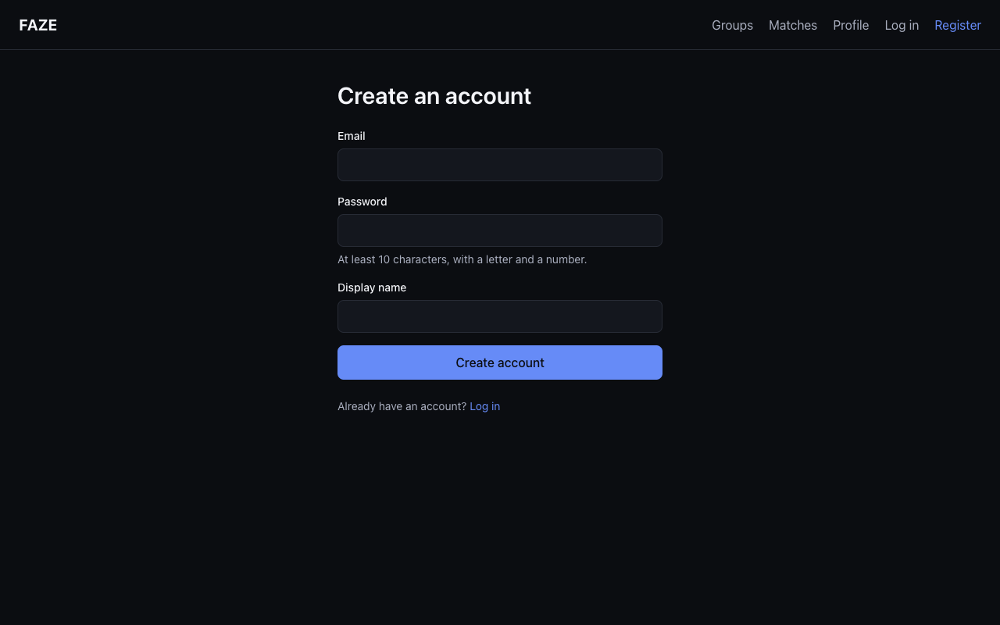

# FAZE — Phase 1 report (draft)

**CS 514: Database Theory and Implementation — Fall 2026**
Team: Bryan Djenabia, Alvin Hoang, nickayvy

> **Status.** Everything below is taken from the repository and the running
> database. Due **19 Oct 2026, 11:59 pm**.

## 1. What FAZE is

FAZE helps a gamer find a group to play with. A person saves the games they
play, their platform, region and weekly free time. FAZE then **ranks open
groups for them** with one SQL query, and they can join a group and chat with
its members.

The problem is that finding people to play with is still manual (Reddit threads,
a huge Discord channel, a game's random matchmaking). None of those look at the
things that decide whether a group sticks together: the same game, the same
region and **overlapping free time**. Those are relational facts, so a
well-designed database answers the question better than a chat channel does.

## 2. Database design

- **ER diagram:** [`er-diagram.md`](er-diagram.md) (two pictures, generated from
  the real tables). 29 application tables, 41 foreign keys, 21 `CHECK`
  constraints. Every foreign key has a deliberately chosen `ON DELETE` rule,
  explained in [`schema.md`](schema.md) §3.
- **Normalisation:** [`normalization.md`](normalization.md) walks one messy
  spreadsheet to 1NF, 2NF and 3NF. All tables are in BCNF except one deliberate,
  defended exception: `lfg_group.member_count` (see section 5).
- **Availability** is stored as UTC minutes since midnight, so "do two people
  overlap?" is plain integer arithmetic in SQL, with no time-zone logic in the
  query.

## 3. Real data

The game catalog comes from a public Steam dataset (the Kaggle source needs an
account token, so the same-shape public mirror was used and is documented in
[`data.md`](data.md)). It goes through a staging step, then a clean-up step that
records everything it refuses.

| Step                                | Rows                                                                   |
| ----------------------------------- | ---------------------------------------------------------------------- |
| Staged                              | 140,082 apps                                                           |
| **Loaded as games**                 | **118,001**                                                            |
| Rejected (and logged with a reason) | 22,081 = 17,891 demos + 2,282 duplicate slugs + 1,908 non-Latin titles |
| Flagged multiplayer                 | 22,821                                                                 |
| Genre links                         | 326,743 across 63 genres                                               |

Re-running the import gives identical counts. A deliberately corrupted file
costs only the damaged tail, not the whole run.

## 4. Database programming

| Object              | Purpose                                                                                 |
| ------------------- | --------------------------------------------------------------------------------------- |
| 6 views             | Group cards, full profile, popularity, member-count check, and others                   |
| 6 stored procedures | Create / join / leave a group, decide a request, record a session, set the primary game |
| 7 triggers          | Keep `member_count` correct, record audit changes, check rating eligibility             |
| 12 migrations       | Numbered, idempotent, each with a tested rollback                                       |

### Key SQL 1 — one trigger keeps the denormalised count right

```sql
CREATE TRIGGER trg_group_member_ai
AFTER INSERT ON group_member
FOR EACH ROW
BEGIN
  IF NEW.state = 'active' THEN
    UPDATE lfg_group SET member_count = member_count + 1 WHERE group_id = NEW.group_id;
    UPDATE lfg_group SET status = 'full'
     WHERE group_id = NEW.group_id AND status = 'recruiting' AND member_count >= max_members;
  END IF;
END;
```

### Key SQL 2 — joining a group safely (the transaction example)

`sp_join_group` starts a transaction and **locks the group's row** before it
checks for a free seat, so two people cannot both take the last one:

```sql
START TRANSACTION;
SELECT max_members, member_count, visibility, ...
  INTO v_max_members, v_member_count, v_visibility, ...
  FROM lfg_group WHERE group_id = p_group_id
  FOR UPDATE;                       -- the lock
-- ... refuse with FULL / ALREADY_MEMBER / REQUIREMENT_* ...
INSERT INTO group_member (group_id, user_id, role, state)
VALUES (p_group_id, p_user_id, 'member', 'active')
ON DUPLICATE KEY UPDATE role = 'member', state = 'active', left_at = NULL;
SET p_result = 'JOINED';
COMMIT;
```

**Proof:** 8 people ran the procedure at the same moment for one free seat, three
times. Every time exactly **1 got `JOINED` and 7 got `FULL`**. Before the count
trigger existed the same test gave 8 of 8 `JOINED`, which is why the trigger and
the lock are both needed (full account: [`schema.md`](schema.md) §9.5).

### Key SQL 3 — a view that a screen can read directly

`v_group_card` joins group, game, region, owner and platforms and adds
`open_slots = max_members - member_count`, so no caller repeats that arithmetic.

### Key SQL 4 — the match query

The score is **50** (same game) **+ 20** (same region) **+ up to 30** (shared
weekly availability). The core of it:

```sql
:gameWeight * same_game
+ :regionWeight * same_region
+ LEAST(:availabilityWeight, :availabilityWeight * overlap_hours / :fullHours) AS score
```

with `overlap_hours` summed from the members' availability slots. The full query,
a worked example and the exact reply are in [`matchmaking.md`](matchmaking.md).
Four automated tests assert the exact scores and ordering.

## 5. The one deliberate denormalisation

`lfg_group.member_count` repeats something the database could count. The browse
and match queries read it for every group, so counting each time would be slow.
Only triggers may change it, and the view `v_member_count_reconciliation` shows
any difference (its `drift` column must always be 0). It was 0 for all 5,000
groups in the performance data set.

## 6. Performance

Measured with `EXPLAIN ANALYZE` on 20,000 users, 5,000 groups and 118,001 games
([`performance.md`](performance.md)):

| Query                               | Before              | After   |
| ----------------------------------- | ------------------- | ------- |
| Browse groups for a game and region | 5.47 ms (full scan) | 0.10 ms |
| Match query (median of 5)           | 295 ms              | 164 ms  |
| Game search                         | 81.6 ms (full scan) | 0.21 ms |

## 7. Security and access control

- Passwords are hashed with **argon2id**; the hash is never logged or returned.
- Every SQL value is a bound parameter; only repositories contain SQL.
- Protected routes require a signed-in user (tested). Group messages are members-only:
  a non-member, or someone who has left, gets `403` on both reading and posting (tested).
  A longer security check is planned for Phase 2.

## 8. Testing

78 automated tests run in CI against a real MySQL: sign-in, profiles, lookups, the
match query, groups (including the 8-people-one-seat race), messages and the
stats route. A further set of key database-integrity tests is planned for
Phase 2.

## 9. Run it yourself

Setup is five commands in the [README](../README.md). The demo logins and a
five-step click-through are in [`demo.md`](demo.md): `npm run db:seed` creates 40
users, 15 groups and 200 messages, and is safe to run again.

## 10. Screenshots

Taken with the demo data ([`demo.md`](demo.md)), signed in as demo users.

**Home**


**Register and log in**




**Profile:** region, platform, play styles, weekly availability and favourite
games.


**Groups:** filtered to Europe West; the last group is full (4 / 4).


**Matches:** open groups ranked by the SQL score, with the reason for each.


**Group detail and chat:** members, the Leave button, and the group's messages.


## 11. Who did what

### Bryan

I set up the project, the automatic checks and the review process, and I designed the database: 29 tables, the migration runner, 6 views, 6 stored procedures and 7 triggers. I loaded 118,001 real games from a public Steam dataset, built the sign-in system, and wrote the matching query, which ranks groups with one SQL score. I also drew the ER diagram, wrote the normalisation explanation, measured the main queries with EXPLAIN, and reviewed and merged the team's work. The trickiest part was the matching query. A group has no schedule of its own, so I used the average time each member shares with the person, and a new index cut the query time from 295 ms to 164 ms.

### Alvin

I built the profile API, which saves a person's region, platforms, play styles, favourite games and weekly availability. Availability is entered in the person's own time zone and converted to UTC before it is saved, including slots that run past midnight, so people in different time zones can be compared fairly. I also added the lookup lists that fill the drop-down menus, and the group messages API, which lets only members of a group read and post messages. Each of these has automated tests, including checks that someone outside the group is refused. The most careful work was the time zone conversion.

### nickayvy

I built the groups API that handled creating, listing, viewing, joining and leaving groups, with joins going through a stored procedure that locks the group's row so a group can never go over its limit. On the website, I built the base, the login, register and profile screens, the groups, matches and group detail screens, and the live chat box. I also wrote the demo data script and took the report screenshots. The trickiest part for me was the demo data script. MySQL does not run triggers on rows deleted by a foreign key cascade, so clearing the old demo data would quietly leave the stored member counts wrong unless the memberships were deleted first.

## 12. What is still open (honest list)

- Everything in the main user flow is built and checked end to end: groups API, screens, messages API, demo data and screenshots.
- Still to do for Phase 2: the key database-integrity tests, the one-page security check, and a one-page guide to running one demo environment.
- RAWG cover art is not loaded; the website shows a placeholder.
- Email sending is not built; accounts are active when they register.
- Optional extras (sessions, ratings, an admin stats page) only if time allows.

---

## Appendix: draft of the discussion post

> **FAZE: gaming group finder.** We built a MySQL-backed web app that ranks
> groups for a gamer using one SQL score: same game, same region, and
> overlapping weekly availability. The schema is normalised to 3NF with one
> deliberate, trigger-protected exception, the group member count. We loaded
> 118,001 real Steam games, and we show that the "last seat" race is safe: eight
> simultaneous joins for one seat give exactly one winner, every time. Indexes
> were chosen using `EXPLAIN ANALYZE` evidence, for example game search went from
> 81.6 ms to 0.21 ms. Alvin built the profile and messages APIs, including the
> time zone conversion for availability. nickayvy built the groups API and the
> website, plus the demo data and the screenshots. Bryan designed the database,
> the matching query and the performance work.
