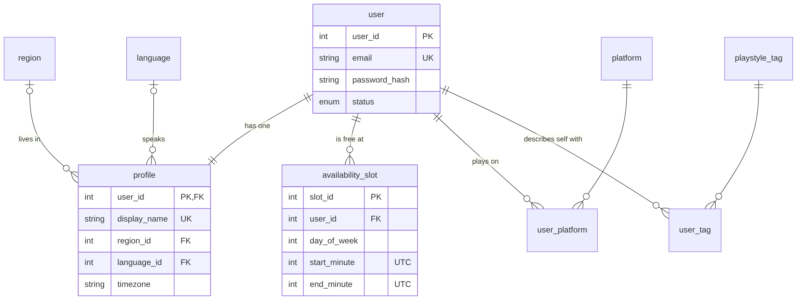
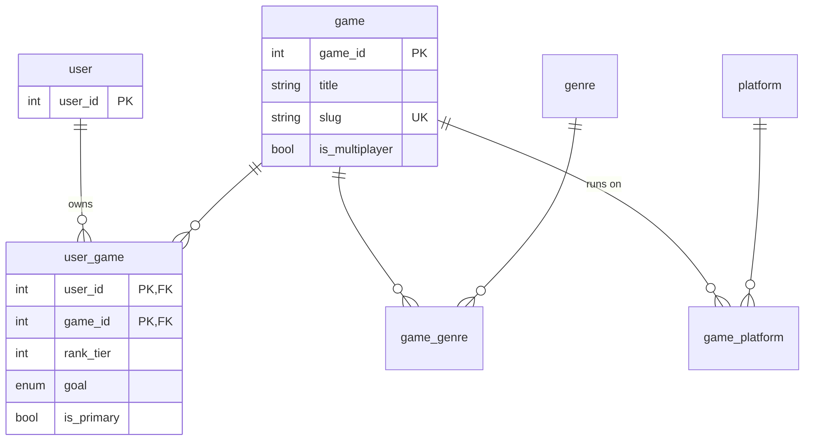
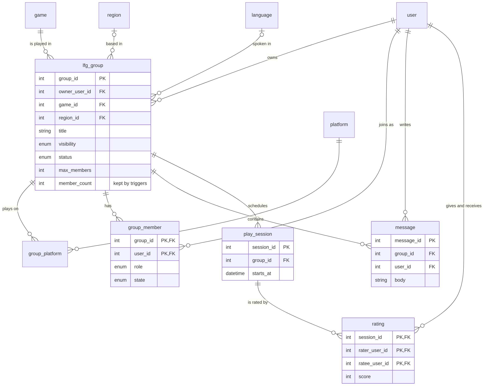
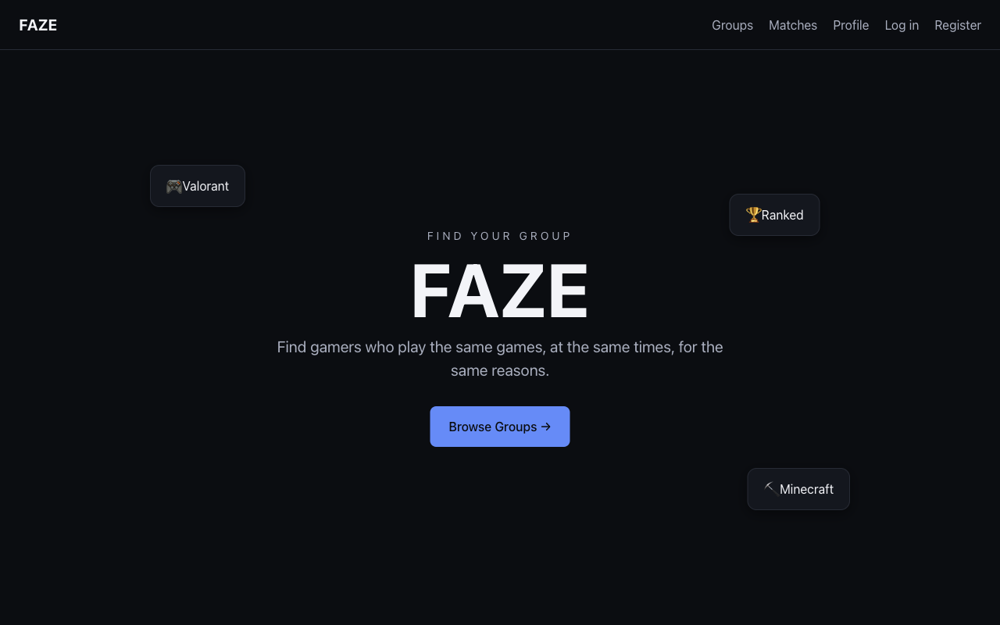
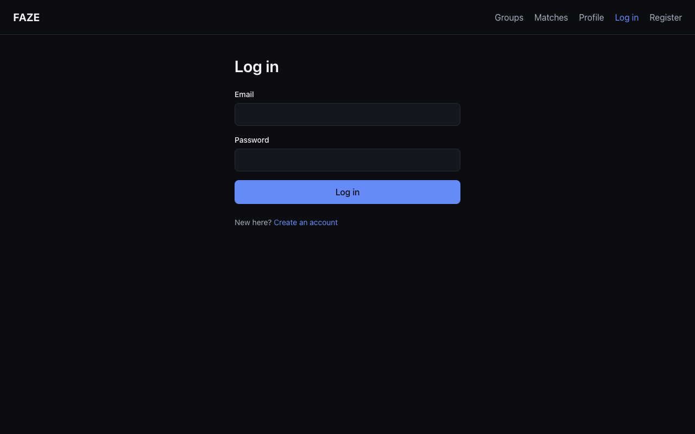
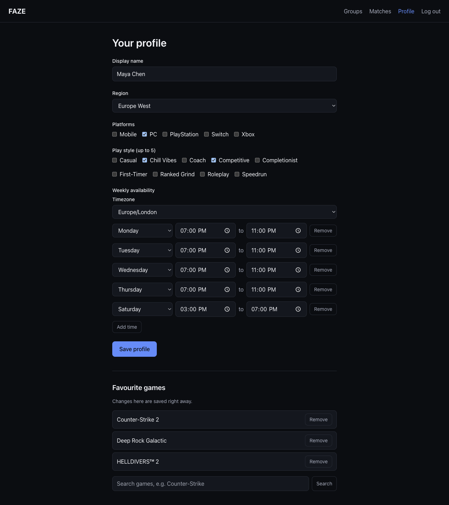
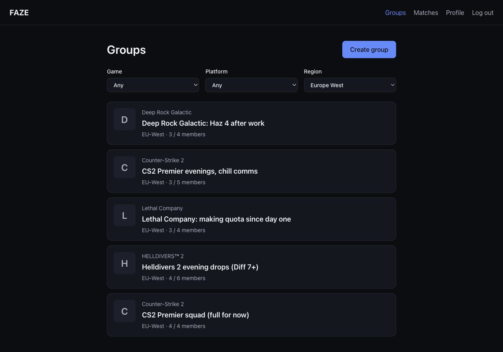
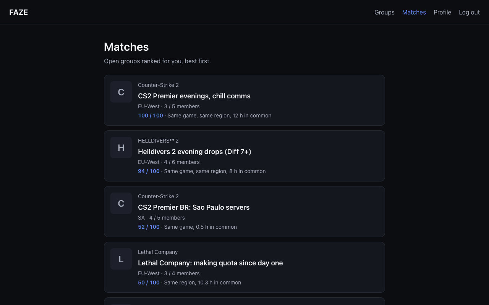
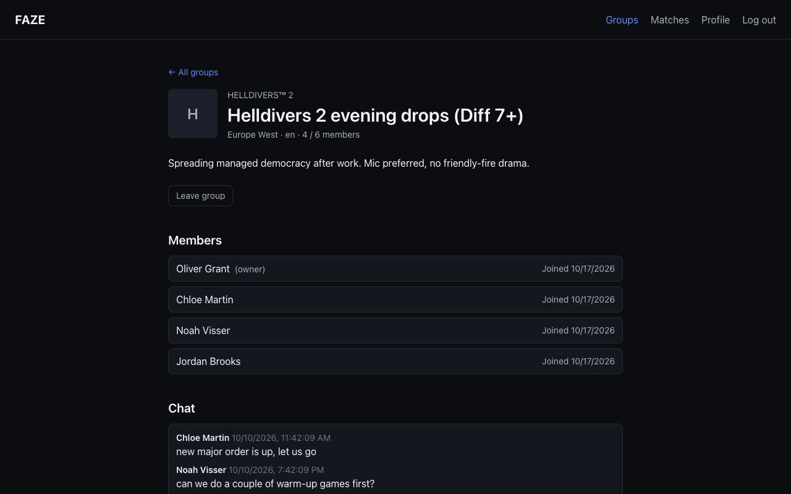
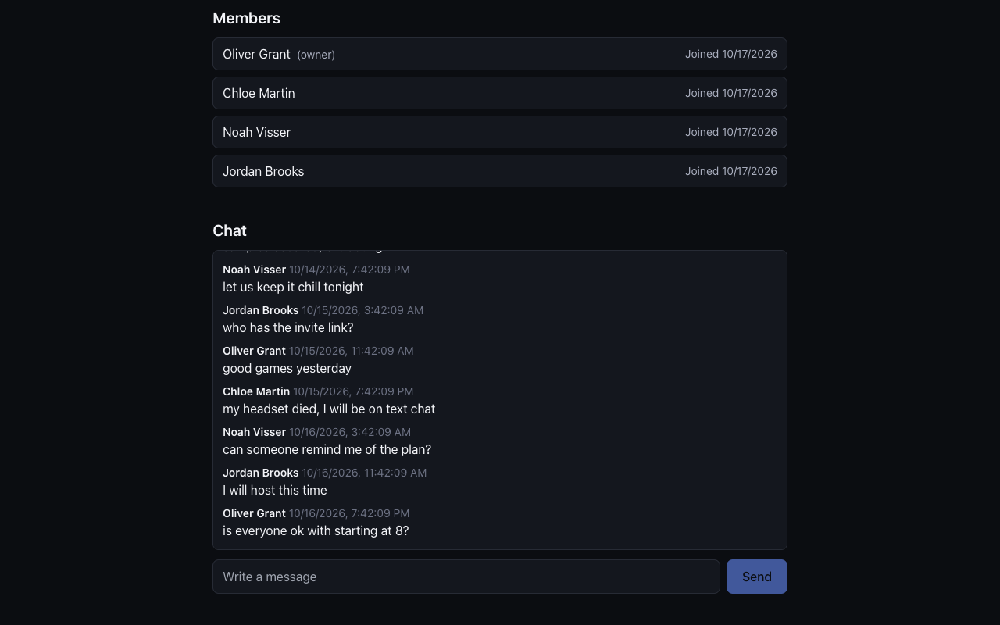

# 1. Overview

**FAZE helps a gamer find a group of real people to play with.** A person saves
the games they play, their platform, their region and their weekly free time.
FAZE then ranks the open groups for that person with one SQL query, and lets
them join a group and chat with its members.

**The problem.** Finding people to play with is still guesswork: Reddit
threads, a huge "looking for group" channel on Discord, or a game's random
matchmaking. None of these look at the three things that decide whether a
group sticks together: playing the same game, being in the same region, and
being free at the same times. Those are facts about people, games and
schedules, which is exactly what a relational database answers well.

**The company.** For this course we present FAZE as a small software company,
FAZE Labs. Its mission is to help every player find a group they actually stick
with.

| Person         | Role                                            |
| -------------- | ----------------------------------------------- |
| Bryan Djenabia | Project lead, database design, the match query  |
| Alvin Hoang    | Profiles, time zones and the group messages API |
| nickayvy       | Groups API, the website, demo data, screenshots |

**Input and output.** The input is a person's profile (games, region,
platform, weekly availability). The output is a ranked list of groups, each with
a score out of 100 and the reasons for it, plus the group pages and chat.

**How we measure success.** (1) The ranking is exactly what the scoring rule
says, checked by automated tests. (2) Joining stays correct when many people
press Join at once. (3) The main queries stay fast on a large data set,
measured with `EXPLAIN ANALYZE`.

# 2. Database design

## 2.1 The schema at a glance

| Item                | Count                                                |
| ------------------- | ---------------------------------------------------- |
| Application tables  | 29                                                   |
| Foreign keys        | 41, each with a deliberately chosen `ON DELETE` rule |
| `CHECK` constraints | 21                                                   |
| Views               | 6                                                    |
| Stored procedures   | 6                                                    |
| Triggers            | 7                                                    |
| Migrations          | 12, numbered, each with a tested rollback            |

The database is MySQL 8 (InnoDB, `utf8mb4`). All SQL is written by hand with
bound parameters; there is no ORM.

## 2.2 ER diagram

The diagram is split into three pictures so the text stays readable. Each one
has its own page. The first shows people: users, profiles, weekly availability,
platforms and play styles.

{.er}

The second shows games: the games people own, and each game's genres and
platforms.

{.er}

The third shows groups: the group itself, its members, messages, sessions and
ratings.

{.er}

## 2.3 Normalisation

We started from one "everything in a spreadsheet" table and took it step by
step to 1NF (no lists inside a cell), 2NF (no column depends on only part of a
key) and 3NF (no column depends on another non-key column). The full walk-through
is in `docs/normalization.md`. Every table is in BCNF except one deliberate
exception.

**The one deliberate denormalisation.** `lfg_group.member_count` repeats a
number the database could count. The browse and match queries read it for every
group, so counting each time would be slow. Only triggers may change it, and the
view `v_member_count_reconciliation` shows any difference between the stored
count and the real count. That difference was 0 for all 5,000 groups in our
performance data set, and the demo data script checks it every time it runs.

## 2.4 Storing availability

Weekly free time is stored as UTC minutes since midnight (for example Monday
18:00 to 20:00 UTC is day 1, minutes 1080 to 1200). People enter times in
their own time zone and the server converts them to UTC before saving,
splitting a slot that runs past midnight into two days. Because of this, the
question "do two people overlap?" is plain integer arithmetic in SQL.

# 3. Implementation

## 3.1 Architecture

| Layer        | Technology                   | Notes                                                    |
| ------------ | ---------------------------- | -------------------------------------------------------- |
| Database     | MySQL 8                      | Schema changes only through migration files              |
| Server       | Node 20, Express, TypeScript | Routes, services, repositories; SQL only in repositories |
| Website      | React, Vite, Tailwind        | Login, profile, groups, matches, group page, chat        |
| Shared types | zod schemas                  | The server and website check the same shapes             |
| Checks       | GitHub Actions               | Lint, type check, build, and tests on a real MySQL       |

## 3.2 Real data

The game catalog comes from a public Steam dataset. It is loaded into a staging
table first, then cleaned, and every rejected row is logged with a reason.

| Step                | Rows                                                            |
| ------------------- | --------------------------------------------------------------- |
| Staged              | 140,082 apps                                                    |
| **Loaded as games** | **118,001**                                                     |
| Rejected and logged | 22,081 (17,891 demos, 2,282 duplicates, 1,908 non-Latin titles) |
| Flagged multiplayer | 22,821                                                          |
| Genre links         | 326,743 across 63 genres                                        |

Running the import again gives the same counts.

## 3.3 Key SQL 1: a trigger keeps the stored count right

```sql
CREATE TRIGGER trg_group_member_ai
AFTER INSERT ON group_member
FOR EACH ROW
BEGIN
  IF NEW.state = 'active' THEN
    UPDATE lfg_group SET member_count = member_count + 1
     WHERE group_id = NEW.group_id;
    UPDATE lfg_group SET status = 'full'
     WHERE group_id = NEW.group_id AND status = 'recruiting'
       AND member_count >= max_members;
  END IF;
END;
```

## 3.4 Key SQL 2: joining a group safely (the transaction)

`sp_join_group` starts a transaction and locks the group's row before it checks
for a free seat, so two people can never both take the last one.

```sql
START TRANSACTION;
SELECT max_members, member_count, visibility
  INTO v_max_members, v_member_count, v_visibility
  FROM lfg_group WHERE group_id = p_group_id
  FOR UPDATE;                         -- the row lock
-- refuse with FULL, ALREADY_MEMBER or a requirement code
INSERT INTO group_member (group_id, user_id, role, state)
VALUES (p_group_id, p_user_id, 'member', 'active')
ON DUPLICATE KEY UPDATE role = 'member', state = 'active', left_at = NULL;
SET p_result = 'JOINED';
COMMIT;
```

**Proof.** Eight people ran the procedure at the same moment for one free seat,
three times. Every time exactly one got `JOINED` and seven got `FULL`. Before
the count trigger existed, the same test let all eight in, which shows why the
lock and the trigger are both needed.

## 3.5 Key SQL 3: the match score

For each open group the score is **50** (same game) **+ 20** (same region)
**+ up to 30** (shared weekly free time). A group has no schedule of its own,
so we use the average number of weekly hours the person shares with each
member; 10 hours or more earns the full 30 points.

```sql
  :gameWeight * same_game
+ :regionWeight * same_region
+ LEAST(:availabilityWeight,
        :availabilityWeight * overlap_hours / :fullHours) AS score
```

Groups that are full, private or already joined are left out. The server only
passes in the user id and returns the rows. Four automated tests check the exact
scores and their order (80, 76, 50 and 20 in the test world).

## 3.6 API

The website talks to 33 JSON routes, including `POST /api/auth/login`,
`PUT /api/profile`, `GET /api/groups`, `POST /api/groups/:id/join`,
`GET /api/matches` and `GET /api/groups/:id/messages`. Every route is listed in
`docs/api.md`.

# 4. Course concepts applied

| Concept                     | Where it appears in FAZE                                                        |
| --------------------------- | ------------------------------------------------------------------------------- |
| ER modelling                | Two-part ER diagram (section 2.2)                                               |
| Keys and constraints        | Primary keys, 41 foreign keys with `ON DELETE` rules, 21 `CHECK` constraints    |
| Normalisation (1NF to BCNF) | Walk-through in `docs/normalization.md`; one defended exception                 |
| Joins and aggregation       | The match query joins profiles, games, members and availability                 |
| Views                       | `v_group_card`, `v_member_count_reconciliation` and four more                   |
| Stored procedures           | Create, join and leave a group; set the primary game                            |
| Triggers                    | Keep `member_count` correct; audit changes; rating checks                       |
| Transactions and locking    | `SELECT ... FOR UPDATE` in `sp_join_group`; the 8-people race test              |
| Indexing and query plans    | Composite, availability and `FULLTEXT` indexes, measured with `EXPLAIN ANALYZE` |
| ETL and data cleaning       | Steam import with a staging table and a reject log                              |
| Security                    | argon2id password hashes, bound parameters, members-only access                 |

# 5. Performance (compared with a baseline)

We filled a separate test database with **20,000 users, 5,000 groups and all
118,001 games**, then measured the three queries that matter with
`EXPLAIN ANALYZE`, without and with the index.

| Query                               | Baseline (no index) | With the index |
| ----------------------------------- | ------------------- | -------------- |
| Browse groups for a game and region | 5.47 ms, full scan  | **0.10 ms**    |
| The match query (median of 5 runs)  | 295 ms              | **164 ms**     |
| Game search by title                | 81.6 ms, full scan  | **0.21 ms**    |

Game search became about 390 times faster with a `FULLTEXT` index. The full
query plans are in `docs/performance.md`.

# 6. Security and testing

- Passwords are hashed with argon2id; the hash is never logged or returned.
- Every SQL value is a bound parameter, and only repository files contain SQL.
- Protected routes need a signed-in user. Group messages are members only: a
  non-member, or someone who has left, is refused on both reading and posting.
- **78 automated tests** run on every pull request against a real MySQL
  database: sign-in, profiles, lookups, the match query, groups (including the
  8-people race) and messages.

# 7. User guide

## 7.1 Run FAZE on your computer

You need Node 20 or newer and either Docker or MySQL 8.

```bash
git clone https://github.com/BryanD17/FAZE.git
cd FAZE
npm install
docker compose up -d      # starts MySQL
cp .env.example .env      # then replace the two "replace-me" secrets
npm run db:migrate        # creates the tables
npm run etl:all           # loads the game list (a few minutes, once)
npm run db:seed           # 40 demo users, 15 groups, 200 messages
npm run dev               # website at http://localhost:5173
```

Every demo login is `<first name>@demo.faze` with the password `DemoPass123`.
The main demo user is `maya@demo.faze`. Run `npm run db:seed` again at any time
to reset the demo.

## 7.2 Using FAZE

**Step 1. Register or log in.** Open the website and create an account, or log
in as a demo user.





**Step 2. Fill in your profile.** Choose your region and platform, your play
styles, your favourite games and the times you are free each week, in your own
time zone. Press **Save profile**.



**Step 3. Browse groups.** The Groups page lists every group. Filter by game or
region. A full group shows its count (for example 4 / 4) and cannot be joined.



**Step 4. See your matches.** The Matches page ranks open groups for you. Each
card shows the score out of 100 and why: same game, same region and shared
hours.



**Step 5. Join a group and chat.** Open a group to see its members. Press
**Join group** and you appear in the member list. Use the chat box to send a
message; other members see it within a few seconds. Press **Leave** to leave.





# 8. Who did what

**Bryan Djenabia.** Set up the project, the automatic checks and the review
process. Designed the database (29 tables, the migration runner, 6 views, 6
stored procedures and 7 triggers), loaded the 118,001 games, built sign-in,
wrote the match query, the ER diagram, the normalisation write-up and the
performance evidence, and reviewed and merged the team's work.

**Alvin Hoang.** Built the profile API, including the conversion of weekly free
time from the person's time zone to UTC, the lookup lists for the drop-down
menus, and the members-only group messages API, each with automated tests.

**nickayvy.** Built the groups API (create, list, view, join and leave), the
whole website including the live chat box, the demo data script and the
screenshots.

# 9. Limitations and next steps

- Accounts are active as soon as they register; email sending is not built.
- Game cover art is not loaded; the website shows a placeholder.
- For Phase 2: key data-integrity tests, a short security check, and one clear
  guide to running the full demo.
- Optional if time allows: scheduling a group session and rating it afterwards.
- Beyond the class: Discord sign-in, a mobile app, and paid tools for gaming
  clubs and esports teams.
